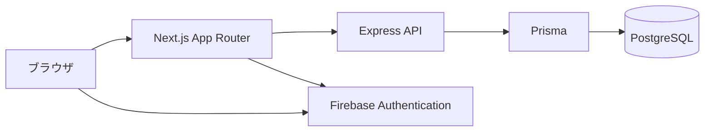

# Akiko Portfolio

学習して作った作品を、その都度コードを書き換えなくても管理画面から追加できるようにした、私自身のポートフォリオサイトです。

公開画面のお問い合わせフォームから送信された内容は、Next.jsのサーバー機能とExpress APIを経由してPostgreSQLへ保存します。

## 制作目的

これまでの仕事で培った「人に寄り添う力」と、現在学習しているWeb開発の知識を一つの画面で伝えるために制作しました。

作品が増えても自分で登録・並び替えできること、公開画面と管理画面を安全に分けることを大切にしています。フロントエンド・バックエンド・データベース・認証をつなぎ、一つのWebアプリケーションとして動かすことにも挑戦しました。

## このアプリで大切にしたこと

| 大切にしたこと | 実装した仕組み |
| --- | --- |
| 学んだ作品を後から増やせる | 管理画面から実績・画像・技術・URLを登録 |
| 見せたい順番を自分で変えられる | 実績とスキルの表示順を数値で管理 |
| 管理画面を本人だけが使える | Firebase認証、管理者UID確認、未認証時の404 |
| 画面だけで終わらせずデータを残す | Prismaを通してPostgreSQLへ保存 |
| 問い合わせをあとから確認できる | `Contact`テーブルへ名前・メール・本文を保存 |

## 主な機能

### 公開画面

* プロフィール、実績、スキルの表示
* PostgreSQLに保存したデータの表示
* PostgreSQLに保存したプロフィール画像の表示
* お問い合わせフォーム
* 送信中・送信成功・送信失敗メッセージの表示
* 管理者ログイン画面へのリンク

### 管理画面

* Firebase Authenticationによるメールアドレス・パスワードログイン
* Firebase Admin SDKによるサーバー側の認証
* 管理者UIDによるアクセス制限
* セッションCookieによるログイン状態の管理
* 未認証で`/admin`へアクセスした場合のHTTP 404応答
* プロフィールの編集
* 見出し・自己紹介で指定した改行の公開画面への反映
* 実績の登録・編集・削除・並び替え
* スキルの登録・編集・削除・並び替え
* プロフィール画像・作品画像の登録・更新
* 画像形式・ファイルサイズの入力チェック
* ログアウト
* 公開サイトを別タブで確認できるリンク

### バックエンド

* Expressによるプロフィール・実績・スキルのCRUD API
* Prismaを使用したPostgreSQLのデータ操作
* お問い合わせ内容の保存
* 内部APIキーによる管理APIの保護
* 必須項目・メール形式・文字数の入力チェック

## システム構成

ブラウザからExpress APIを直接呼ばず、Next.jsのサーバー機能を経由します。



主に次のNext.jsサーバー機能を使用しています。

* Server Component：公開画面・管理画面のデータ取得
* Server Action：管理画面の更新・お問い合わせ送信
* Route Handler：認証・公開画像・公開データの中継

## データの流れ

### 公開データの取得

```text
ブラウザ
→ Next.js Server Component / Route Handler
→ Express API
→ Prisma
→ PostgreSQL
```

### 管理画面からの更新

```text
管理画面
→ Next.js Server Action
→ 管理者認証
→ 内部APIキー付きのExpress管理API
→ Prisma
→ PostgreSQL
```

### お問い合わせの送信

```text
お問い合わせフォーム
→ Next.js Server Action
→ Express API
→ Prisma
→ PostgreSQLのContactテーブル
```

## 使用技術

| 分類      | 技術                 | バージョン            |
| ------- | ------------------ | ---------------- |
| 実行環境    | Node.js            | 24.15.0          |
| フロントエンド | Next.js            | 16.2.11          |
| UI      | React              | 19.2.4           |
| CSS     | Tailwind CSS       | 4                |
| バックエンド  | Express            | 5.2.1            |
| ORM     | Prisma             | 7.9.0            |
| データベース  | PostgreSQL         | 16               |
| 認証      | Firebase           | 12.16.0          |
| サーバー認証  | Firebase Admin SDK | 14.2.0           |
| コンテナ    | Docker Compose     | PostgreSQLの起動に使用 |

フロントエンド・バックエンドともにTypeScriptを使用しています。

## データベース

| モデル       | 保存する内容                    |
| --------- | ------------------------- |
| `Profile` | 名前、見出し、自己紹介、地域、プロフィール画像   |
| `Work`    | 実績、説明、使用技術、URL、表示順、画像     |
| `Skill`   | スキル名、説明、カテゴリー、表示順         |
| `Contact` | お名前、メールアドレス、お問い合わせ内容、確認状態 |

プロフィール画像と作品画像はGitリポジトリへ保存せず、`Profile`・`Work`の`imageData`と`imageMimeType`を使用してPostgreSQLへ保存します。

より詳しいER図・処理の流れ・画面とAPIの対応は、[技術ドキュメント](docs/portfolio-review.md)にまとめています。

## 主なExpress API

### 公開API

| メソッド | パス                   | 内容           |
| ---- | -------------------- | ------------ |
| GET  | `/health`            | Expressの起動確認 |
| GET  | `/api/profile`       | プロフィール取得     |
| GET  | `/api/works`         | 実績一覧取得       |
| GET  | `/api/skills`        | スキル一覧取得      |
| GET  | `/api/profile/image` | プロフィール画像取得   |
| GET  | `/api/works/:id/image` | 作品画像取得   |

### お問い合わせAPI

内部APIキーで保護し、Next.jsサーバー（Server Action）からだけアクセスします。

| メソッド | パス             | 内容       |
| ---- | -------------- | -------- |
| POST | `/api/contact` | お問い合わせ登録 |

### 管理API

管理APIは内部APIキーで保護し、Next.jsサーバーからアクセスします。

| メソッド   | パス                             | 内容         |
| ------ | ------------------------------ | ---------- |
| POST   | `/api/admin/profile`           | プロフィール登録   |
| PUT    | `/api/admin/profile/:id`       | プロフィール更新   |
| DELETE | `/api/admin/profile/:id`       | プロフィール削除   |
| PUT    | `/api/admin/profile/:id/image` | プロフィール画像更新 |
| POST   | `/api/admin/works`             | 実績登録       |
| PUT    | `/api/admin/works/:id`         | 実績更新       |
| DELETE | `/api/admin/works/:id`         | 実績削除       |
| PUT    | `/api/admin/works/:id/image`   | 作品画像更新     |
| POST   | `/api/admin/skills`            | スキル登録      |
| PUT    | `/api/admin/skills/:id`        | スキル更新      |
| DELETE | `/api/admin/skills/:id`        | スキル削除      |

## 認証・セキュリティ

* Firebase Authenticationによるメールアドレス・パスワードログイン
* Firebase Admin SDKによるIDトークン・セッションCookieの検証
* 管理者UIDによる認可
* 未認証・管理者以外の`/admin`アクセスにHTTP 404を返す処理
* `httpOnly`のセッションCookie
* 内部APIキーによるExpress管理API・お問い合わせAPIの保護（`timingSafeEqual`で比較）
* Next.jsサーバーからExpress管理APIへのアクセス
* `helmet`によるセキュリティ用HTTPヘッダーの付与
* お問い合わせのスパム対策
  * ハニーポット（人には見えない入力欄に入力があれば保存しない）
  * サイト全体の回数制限（直近10分で10件まで。超えた場合はHTTP 429）
* フロントエンドとバックエンド双方での入力チェック
* 画像のMIMEタイプとファイルサイズの確認
* `.env`と`.env.local`のGit管理対象外設定

## ディレクトリ構成

```text
akiko-portfolio/
├─ frontend/
│  ├─ src/app/               # Next.js App Routerのページ・Server Action
│  └─ src/lib/               # Firebase・Express接続・認証処理
├─ backend/
│  ├─ prisma/                # Prismaスキーマ・マイグレーション
│  └─ src/
│     ├─ lib/                # Prisma Client
│     └─ routes/             # 公開API・管理API・画像API
├─ docker-compose.yml        # PostgreSQL
└─ README.md
```

## 必要な環境

* Node.js 24
* npm
* Docker Desktop
* Firebaseプロジェクト

## 環境変数

実際の値を含む環境変数ファイルはGitHubへ追加しません。

### バックエンド

`backend/.env`に、主に次の設定が必要です。

```text
DATABASE_URL
INTERNAL_API_KEY
PORT
```

### フロントエンド

`frontend/.env.local`に、主に次の設定が必要です。

```text
BACKEND_URL
INTERNAL_API_KEY
FIREBASE_ADMIN_UID
NEXT_PUBLIC_FIREBASE_API_KEY
NEXT_PUBLIC_FIREBASE_AUTH_DOMAIN
NEXT_PUBLIC_FIREBASE_PROJECT_ID
NEXT_PUBLIC_FIREBASE_STORAGE_BUCKET
NEXT_PUBLIC_FIREBASE_MESSAGING_SENDER_ID
NEXT_PUBLIC_FIREBASE_APP_ID
FIREBASE_CLIENT_EMAIL
FIREBASE_PRIVATE_KEY
```

見本は`frontend/.env.example`にあります。

`FIREBASE_CLIENT_EMAIL`と`FIREBASE_PRIVATE_KEY`は、Firebase Admin SDK用の認証情報です。
Firebase Consoleの「プロジェクトの設定」→「サービスアカウント」→「新しい秘密鍵を生成」でダウンロードしたJSONの、`client_email`と`private_key`を設定します。
`private_key`は`"`で囲み、`\n`を含んだ1行のまま貼り付けます。
ダウンロードしたJSONファイルはリポジトリ内に置かず、値を設定した後は安全な場所で保管するか削除してください。

Firebase ConsoleのAuthenticationで「メール／パスワード」を有効にし、
管理者ユーザーを1人作成します。そのユーザーのUIDを
`FIREBASE_ADMIN_UID`へ設定してください。管理者以外のUIDで
セッションを作成しようとした場合はHTTP 404を返します。

`INTERNAL_API_KEY`は、フロントエンドとバックエンドへ同じ値を設定します。

値が一致していない場合は、プロジェクトのルートで次を実行すると、
安全なランダム値を生成して両方のファイルへ同じ値を設定できます。

```bash
node scripts/sync-internal-api-key.mjs
```

実行後は、ExpressとNext.jsを両方とも再起動してください。

## セットアップ

### 1. リポジトリを取得

```bash
git clone https://github.com/ms-engineer-bc26-05/akiko-portfolio.git
cd akiko-portfolio
```

### 2. パッケージをインストール

```bash
cd frontend
npm ci

cd ../backend
npm ci
```

### 3. PostgreSQLを起動

プロジェクトのルートで実行します。

```bash
cd ..
docker compose up -d
docker compose ps
```

`docker compose ps`で`healthy`と表示されれば起動完了です。

### 4. Prismaを準備

```bash
cd backend
npx prisma generate
npx prisma migrate deploy
```

### 5. Expressを起動

```bash
cd backend
npm run dev
```

Expressは次のURLで起動します。

```text
http://localhost:4000
```

起動確認：

```text
http://localhost:4000/health
```

### 6. Next.jsを起動

別のターミナルで実行します。

```bash
cd frontend
npm run dev
```

公開画面：

```text
http://localhost:3000
```

管理者ログイン：

```text
http://localhost:3000/admin/login
```

## 確認用コマンド

### フロントエンド

```bash
cd frontend
npm run format:check
npm run test
npm run lint
npm run build
```

### バックエンド

```bash
cd backend
npm run format:check
npm run test
npm run lint
npm run build
```

`format:check`で整形のずれが見つかった場合は、`npm run format`で自動整形できます。
Node.jsのバージョンは`.nvmrc`（24）にそろえています。

### Prisma

```bash
cd backend
npx prisma validate
npx prisma migrate status
```

### Docker

```bash
docker compose ps
```

通常の停止では、データを保持するため`-v`を付けません。

```bash
docker compose down
```

## 課題要件への対応

| MUST要件                        | 対応内容                                            |
| ----------------------------- | ----------------------------------------------- |
| TypeScript・Next.js App Router | フロントエンドで使用                                      |
| TypeScript・Express            | バックエンドで使用                                       |
| Prisma・PostgreSQL             | データの取得・登録・更新・削除で使用                              |
| Next.jsサーバー機能からExpressへアクセス   | Server Component・Server Action・Route Handlerで対応 |
| プロフィール・実績・スキル                 | PostgreSQLのデータを公開画面へ表示                          |
| プロフィール画像                      | PostgreSQLへバイナリデータとして保存                         |
| お問い合わせフォーム                    | Server ActionからExpressを経由してContactへ保存           |
| Firebase認証・認可                 | メール・パスワードログイン・Admin SDK・管理者UIDで対応      |
| 未認証時のHTTP 404                 | `/admin`への未認証アクセスで対応                            |
| 画像の登録・更新                      | 管理画面から実行可能                                      |
| Firebase設定の環境変数管理             | `.env.local`で管理し、Git管理対象外に設定                    |

## 今後の改善

* 管理画面でのお問い合わせ一覧・既読管理
* 画像の削除機能
* フォーム送信結果を画面内へ表示する改善
* 本番環境へのデプロイ
