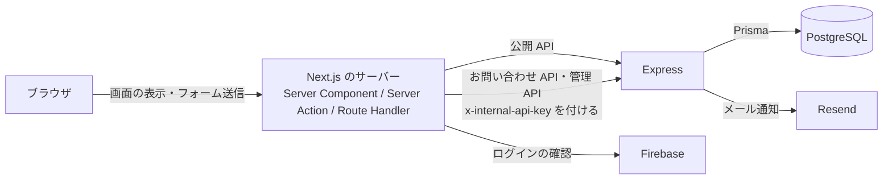
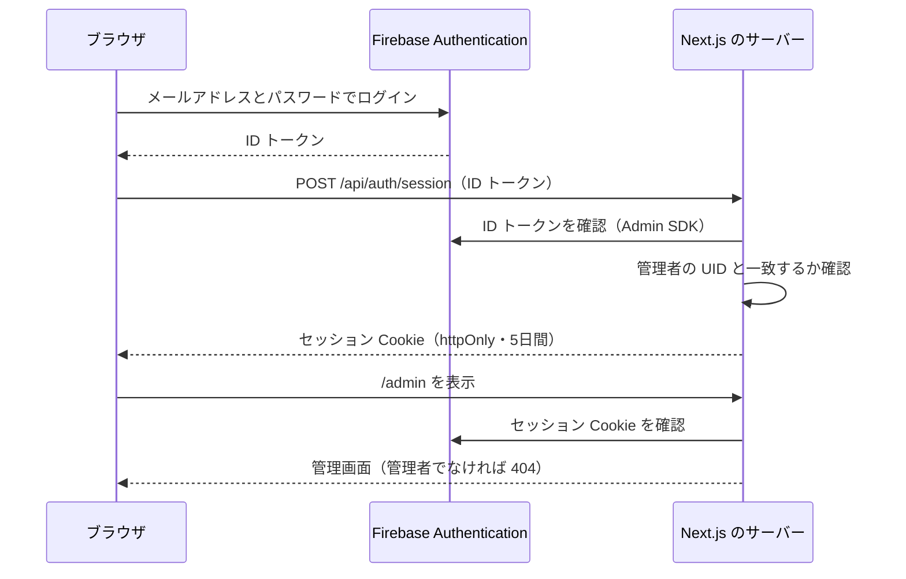

# API 設計

- **対象**：Akiko Portfolio（個人ポートフォリオサイト）
- **作成日**：2026-11-28
- **状態**：確定（現在のコードをもとに作成）。API を変えたときは、この文書も更新する
- **正とするもの**：`backend/src/routes/`・`backend/src/index.ts`（Express）、`frontend/src/app/`（Next.js）
- **関連**：[要件定義](./要件定義.md)／[DB 設計](./DB設計.md)／[技術選定](./技術選定.md)

## 1. 全体の流れ

ブラウザは Express を直接呼ばない。必ず Next.js のサーバーを通す。



| 層 | 役割 |
| --- | --- |
| Next.js のサーバー | 画面の組み立て、管理者かどうかの確認、内部 API キーを付けて Express を呼ぶ |
| Express | 入力チェック、DB の読み書き、メール通知 |

## 2. 共通ルール（Express）

### データの形式

- リクエストとレスポンスは JSON（画像の登録と取得だけは、画像のデータそのもの）
- 日時は ISO 8601 形式の文字列（例：`2026-11-28T01:54:49.000Z`、UTC）
- 公開 API のレスポンスには、画像のデータ（`imageData`）を含めない。画像があるかは `imageMimeType` で判断し、画像は専用の API で取得する

### エラーの形式

```json
{ "error": "スキルが見つかりません" }
```

`error` には、管理画面にそのまま出せる日本語の文を入れる。

### ステータスコード

| コード | 意味 | 主な場面 |
| --- | --- | --- |
| 200 | 成功 | 取得・更新 |
| 201 | 作成した | 登録・お問い合わせの受付 |
| 204 | 成功（返す内容なし） | 削除 |
| 400 | 入力が正しくない | 必須項目がない、文字数オーバー、ID が正しくない、画像の形式が違う |
| 401 | 内部 API キーが違う | Vercel と Render のキーが一致していない |
| 404 | 見つからない | 指定した ID のデータや画像がない |
| 413 | 大きすぎる | 画像が 1MB を超えている |
| 429 | 回数制限 | お問い合わせが、サイト全体で10分間に10件を超えた |
| 500 | サーバーのエラー | DB に接続できない、環境変数が足りない |

### 認証

| 種類 | 対象 | 方法 |
| --- | --- | --- |
| なし | 公開 API | 誰でも呼べる（読み取りのみ） |
| 内部 API キー | お問い合わせ API・管理 API | ヘッダー `x-internal-api-key` を、環境変数 `INTERNAL_API_KEY` と比べる（`timingSafeEqual` を使い、比べる時間からキーを推測されないようにする） |

管理者かどうかの確認（Firebase）は Next.js 側で行う。Express は「Next.js のサーバーから来たか」だけを確かめる。

### ID の扱い

URL の `:id` は 1 以上の整数だけを受け付ける（`backend/src/validation/parse-id.ts`）。それ以外は 400 を返す。

## 3. Express の API 一覧

### 公開 API

| メソッド | パス | 内容 | 成功 | 主なエラー |
| --- | --- | --- | --- | --- |
| GET | `/health` | 起動確認（Render のヘルスチェック） | 200 | － |
| GET | `/api/profile` | プロフィール（`id` が一番小さい1件。なければ `null`） | 200 | 500 |
| GET | `/api/works` | 実績の一覧（表示順） | 200 | 500 |
| GET | `/api/skills` | スキルの一覧（表示順） | 200 | 500 |
| GET | `/api/profile/image` | プロフィール画像 | 200 | 404・500 |
| GET | `/api/works/:id/image` | 作品画像 | 200 | 400・404・500 |

画像の API は `Content-Type` に画像の形式を入れ、`Cache-Control: no-store` を付けて返す。

### お問い合わせ API（内部 API キーが必要）

| メソッド | パス | 内容 | 成功 | 主なエラー |
| --- | --- | --- | --- | --- |
| POST | `/api/contact` | お問い合わせを保存し、メール通知を送る | 201 | 400・401・429・500 |

メール通知は保存のあとに行い、失敗しても 201 を返す（保存は取り消さない）。

### 管理 API（内部 API キーが必要）

| メソッド | パス | 内容 | 成功 | 主なエラー |
| --- | --- | --- | --- | --- |
| POST | `/api/admin/profile` | プロフィールを登録 | 201 | 400・401・500 |
| PUT | `/api/admin/profile/:id` | プロフィールを更新 | 200 | 400・401・404・500 |
| DELETE | `/api/admin/profile/:id` | プロフィールを削除 | 204 | 400・401・404・500 |
| PUT | `/api/admin/profile/:id/image` | プロフィール画像を登録・更新 | 200 | 400・401・404・413・500 |
| POST | `/api/admin/works` | 実績を登録 | 201 | 400・401・500 |
| PUT | `/api/admin/works/:id` | 実績を更新 | 200 | 400・401・404・500 |
| DELETE | `/api/admin/works/:id` | 実績を削除 | 204 | 400・401・404・500 |
| PUT | `/api/admin/works/:id/image` | 作品画像を登録・更新 | 200 | 400・401・404・413・500 |
| POST | `/api/admin/skills` | スキルを登録 | 201 | 400・401・500 |
| PUT | `/api/admin/skills/:id` | スキルを更新 | 200 | 400・401・404・500 |
| DELETE | `/api/admin/skills/:id` | スキルを削除 | 204 | 400・401・404・500 |
| GET | `/api/admin/contacts` | お問い合わせ一覧（新しい順に最大50件）と未読数 | 200 | 401・500 |
| PATCH | `/api/admin/contacts/:id/read` | 既読・未読を切り替える | 200 | 400・401・404・500 |

お問い合わせ一覧は個人情報を含むため、`Cache-Control: no-store` を付けて返す。

## 4. リクエスト・レスポンスの例

### スキルの一覧を取得する

`GET /api/skills`

```json
[
  {
    "id": 9,
    "name": "TypeScript",
    "description": "型を利用した安全なコード作成",
    "category": "Language",
    "displayOrder": 10,
    "createdAt": "2026-11-14T00:21:57.850Z",
    "updatedAt": "2026-11-14T00:21:57.850Z"
  }
]
```

### スキルを更新する

`PUT /api/admin/skills/9`（ヘッダー：`x-internal-api-key`）

```json
{
  "name": "TypeScript",
  "description": "このサイトやチーム開発で、画面とサーバーの両方に使用",
  "category": "Language",
  "displayOrder": 10
}
```

成功すると 200 で、更新後のスキルを返す。`description` と `category` は空にでき、空の場合は `null` で保存する。

### 実績を登録する

`POST /api/admin/works`（ヘッダー：`x-internal-api-key`）

```json
{
  "title": "Akiko Portfolio",
  "description": "このサイトです。",
  "technologies": ["Next.js", "Express", "PostgreSQL"],
  "githubUrl": "https://github.com/AkikoFujikawa/akiko-portfolio",
  "demoUrl": "https://akiko-portfolio-six.vercel.app",
  "displayOrder": 10
}
```

成功すると 201 で、登録した実績を返す。

### 画像を登録・更新する

`PUT /api/admin/works/12/image`（ヘッダー：`x-internal-api-key`、`Content-Type: image/png` など）

本文は画像のデータそのもの（JSON ではない）。JPEG・PNG・WebP のみ、1MB まで。成功すると 200 で、実績の `id` と `imageMimeType` などを返す。

### お問い合わせを送る

`POST /api/contact`（ヘッダー：`x-internal-api-key`）

```json
{
  "name": "山田 花子",
  "email": "hanako@example.com",
  "message": "ポートフォリオを拝見しました。"
}
```

成功すると 201 を返す。

```json
{
  "message": "お問い合わせを受け付けました",
  "contact": { "id": 5, "createdAt": "2026-11-28T01:54:49.000Z" }
}
```

### お問い合わせを既読にする

`PATCH /api/admin/contacts/5/read`（ヘッダー：`x-internal-api-key`）

```json
{ "isRead": true }
```

成功すると 200 で `{ "id": 5, "isRead": true }` を返す。

## 5. Next.js 側の窓口

ブラウザから直接呼ばれるのは、次の Route Handler と Server Action だけ。

### Route Handler

| メソッド | パス | 内容 | 呼び出す Express |
| --- | --- | --- | --- |
| POST | `/api/auth/session` | ログイン：ID トークンを確認し、セッション Cookie（5日間・`httpOnly`）を発行する | － |
| POST | `/api/auth/logout` | ログアウト：セッション Cookie を消す | － |
| GET | `/api/profile-image` | プロフィール画像を表示する | `/api/profile/image` |
| GET | `/api/work-image/:id` | 作品画像を表示する | `/api/works/:id/image` |
| GET | `/api/portfolio` | プロフィール・実績・スキルをまとめて返す | 公開 API の3つ |

`/api/auth/session` は、管理者以外の UID なら 404、ログインから5分以上たった ID トークンなら 401 を返す。

### Server Action

フォームの送信先。管理画面の Server Action は、最初に `requireAdmin()` でセッション Cookie を確認し、管理者でなければ 404 にする。

| Server Action | 画面 | 呼び出す Express |
| --- | --- | --- |
| `sendContact` | 公開画面のお問い合わせ | `POST /api/contact` |
| `updateProfile` | 管理画面 | `PUT /api/admin/profile/:id` |
| `updateProfileImage` | 管理画面 | `PUT /api/admin/profile/:id/image` |
| `createWork`・`updateWork`・`deleteWork` | 管理画面 | 実績の POST・PUT・DELETE |
| `updateWorkImage` | 管理画面 | `PUT /api/admin/works/:id/image` |
| `createSkill`・`updateSkill`・`deleteSkill` | 管理画面 | スキルの POST・PUT・DELETE |
| `updateContactRead` | 管理画面 | `PATCH /api/admin/contacts/:id/read` |

管理画面で保存したあとは、公開画面のキャッシュを作り直す（`updateTag`）。

`sendContact` は、ハニーポット（人には見えない入力欄）に入力があれば、保存せずに「送信しました」と返す。ボットに見破られないようにするため。

## 6. ログインの流れ



## 7. 未確定事項

次の3つ（使っていない API・413 の返し方・管理 API のレスポンスの中身）は、#42 で整理する。

- **使っていない API**：プロフィールの登録（`POST /api/admin/profile`）と削除（`DELETE /api/admin/profile/:id`）、Next.js の `GET /api/portfolio` は、今の画面からは呼んでいない。残すか消すかは未定
- **413 の返し方**：画像が 1MB を超えたときの 413 は、Express の標準の処理で返している。ほかのエラーと同じ `{ "error": "..." }` の形にそろえるかは未定
- **管理 API のレスポンスの中身**：プロフィールと実績の登録・更新は、画像のデータ（`imageData`）も含めて返している。Next.js 側では使っていないため、返す項目を絞るかは未定
- **API の仕様書の形式**：OpenAPI（`openapi.yaml`）などの機械で読める形式は作っていない
