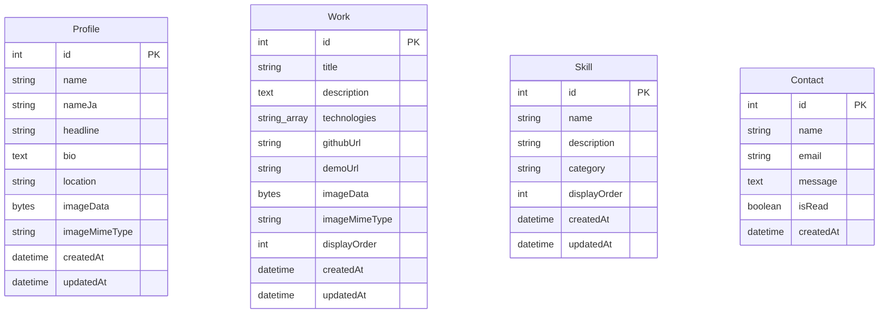

# DB 設計

- **対象**：Akiko Portfolio（個人ポートフォリオサイト）
- **作成日**：2026-11-28
- **状態**：確定（現在のスキーマをもとに作成）。スキーマを変えたときは、この文書も更新する
- **正とするもの**：`backend/prisma/schema.prisma`（この文書と食い違ったときは、スキーマが正）
- **関連**：[要件定義](./要件定義.md)／[技術選定](./技術選定.md)

## 1. 設計方針

- **DBMS**：PostgreSQL（開発：Docker Compose の 16／本番：Neon）
- **操作方法**：Prisma Client だけを使い、SQL を文字列で組み立てない
- **命名規則**：テーブル名・カラム名は Prisma のモデル名・フィールド名をそのまま使う（テーブルは PascalCase の単数形、カラムは camelCase）
- **主キー**：すべて `id`（整数の自動採番）
- **時刻**：`createdAt`（作成日時）と、更新があるテーブルは `updatedAt`（更新日時）を持つ。Prisma が UTC で保存し、画面では日本時間で表示する
- **削除方針**：物理削除（実際に行を消す）。テーブル同士のつながりがないため、削除の影響はそのテーブルの中だけで済む
- **画像**：別のストレージを使わず、各テーブルの `imageData`（バイナリ）と `imageMimeType`（画像の形式）に保存する
- **入力チェック**：文字数の上限などは DB では制限せず、アプリ側（ブラウザ・Next.js・Express）で確認する（上限は[要件定義](./要件定義.md)の §4）
- **マイグレーション**：開発では `prisma migrate dev`、本番では Render の起動時に `prisma migrate deploy` を実行する。マージ済みのマイグレーションファイルは書き換えず、変更は新しいファイルで行う

## 2. ER 図

4つのテーブルは、外部キーでつながっていない。それぞれが独立している。

**つながりを持たせていない理由**：実績で使った技術（`Work.technologies`）とスキル（`Skill`）は、似ているが役割が違う。実績の技術は作品ごとの記録、スキルは自分の得意分野の紹介なので、別々に管理したほうが、どちらかを直したときにもう一方へ影響しない。

## 3. テーブル定義

型は「Prisma の型（PostgreSQL の型）」で書く。必須の「○」は NULL を許さないことを表す。

### Profile（プロフィール）

公開画面の上部と「プロフィール」欄に表示する。

| カラム | 型 | 必須 | 既定値 | 説明 |
| --- | --- | --- | --- | --- |
| id | Int（SERIAL） | ○ | 自動採番 | 主キー |
| name | String（TEXT） | ○ | | 英語の名前 |
| nameJa | String（TEXT） | | | 日本語の名前 |
| headline | String（TEXT） | ○ | | トップの見出し。改行を含められる |
| bio | String（TEXT） | ○ | | 自己紹介。改行を含められる |
| location | String（TEXT） | | | 所在地 |
| imageData | Bytes（BYTEA） | | | プロフィール画像のデータ |
| imageMimeType | String（TEXT） | | | 画像の形式（`image/jpeg`・`image/png`・`image/webp`） |
| createdAt | DateTime（TIMESTAMP(3)） | ○ | 作成時刻 | 作成日時 |
| updatedAt | DateTime（TIMESTAMP(3)） | ○ | | 更新日時（Prisma が自動で更新） |

公開画面では、`id` が一番小さい1件を使う。

### Work（実績）

公開画面の「実績」欄に表示する。

| カラム | 型 | 必須 | 既定値 | 説明 |
| --- | --- | --- | --- | --- |
| id | Int（SERIAL） | ○ | 自動採番 | 主キー |
| title | String（TEXT） | ○ | | 作品名 |
| description | String（TEXT） | ○ | | 説明。改行を含められる |
| technologies | String[]（TEXT[]） | | | 使用技術の一覧（配列） |
| githubUrl | String（TEXT） | | | GitHub の URL |
| demoUrl | String（TEXT） | | | 公開サイトの URL |
| imageData | Bytes（BYTEA） | | | 作品画像のデータ |
| imageMimeType | String（TEXT） | | | 画像の形式 |
| displayOrder | Int（INTEGER） | ○ | 0 | 表示順。小さいほど上 |
| createdAt | DateTime（TIMESTAMP(3)） | ○ | 作成時刻 | 作成日時 |
| updatedAt | DateTime（TIMESTAMP(3)） | ○ | | 更新日時 |

並び順：`displayOrder` の小さい順。同じ値のときは `id` の小さい順。

### Skill（スキル）

公開画面の「スキル」欄に、カテゴリーごとに表示する。

| カラム | 型 | 必須 | 既定値 | 説明 |
| --- | --- | --- | --- | --- |
| id | Int（SERIAL） | ○ | 自動採番 | 主キー |
| name | String（TEXT） | ○ | | スキル名 |
| description | String（TEXT） | | | 何に使ったかの説明。空ならスキル名だけを表示する |
| category | String（TEXT） | | | 見出しにするカテゴリー。空なら「その他」にまとめる |
| displayOrder | Int（INTEGER） | ○ | 0 | 表示順。小さいほど上 |
| createdAt | DateTime（TIMESTAMP(3)） | ○ | 作成時刻 | 作成日時 |
| updatedAt | DateTime（TIMESTAMP(3)） | ○ | | 更新日時 |

並び順：`displayOrder` の小さい順。同じ値のときは `id` の小さい順。カテゴリーの並びは、その中で一番先に出てくるスキルの順になる。

### Contact（お問い合わせ）

公開画面のフォームから保存し、管理画面で確認する。**個人情報を含むため、ログやメール通知には出さない。**

| カラム | 型 | 必須 | 既定値 | 説明 |
| --- | --- | --- | --- | --- |
| id | Int（SERIAL） | ○ | 自動採番 | 主キー |
| name | String（TEXT） | ○ | | 送信者の名前 |
| email | String（TEXT） | ○ | | 送信者のメールアドレス |
| message | String（TEXT） | ○ | | 本文 |
| isRead | Boolean（BOOLEAN） | ○ | false | 管理者が確認したか |
| createdAt | DateTime（TIMESTAMP(3)） | ○ | 作成時刻 | 受信日時 |

並び順（管理画面）：`createdAt` の新しい順に最大50件。同じ時刻のときは `id` の大きい順。
送信回数の制限では、直近10分間の `createdAt` の件数を数える。

## 4. 画面・API との対応

| テーブル | 読む | 書く |
| --- | --- | --- |
| Profile | 公開画面（P-1）、管理画面 | 管理画面（A-3、A-6） |
| Work | 公開画面（P-2）、管理画面 | 管理画面（A-4、A-6） |
| Skill | 公開画面（P-3）、管理画面 | 管理画面（A-5） |
| Contact | 管理画面（A-7） | 公開画面のフォーム（P-4）、管理画面の既読切り替え（A-7） |

番号は[要件定義](./要件定義.md)の機能 ID。

## 5. マイグレーション履歴

| ファイル | 内容 |
| --- | --- |
| `20260725121745_init` | 4つのテーブルを作成 |

## 6. 未確定事項

- **Profile の件数**：DB では1件に制限していない。2件以上あると、公開画面には `id` が一番小さいものだけが出る。1件に制限するかは未定
- **インデックス**：主キー以外は作っていない。件数が少ないため現状は不要。お問い合わせが増えて一覧が遅くなったら、`Contact.createdAt` に追加を検討する
- **画像の削除**：画像を消して空に戻す機能はない（差し替えのみ）
- **画像の保存先**：件数や容量が増えたら、ストレージサービスへの移行を検討する
