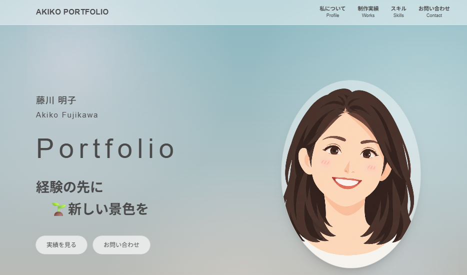
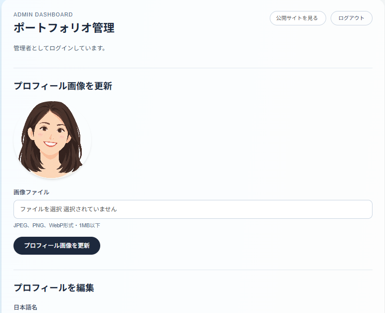
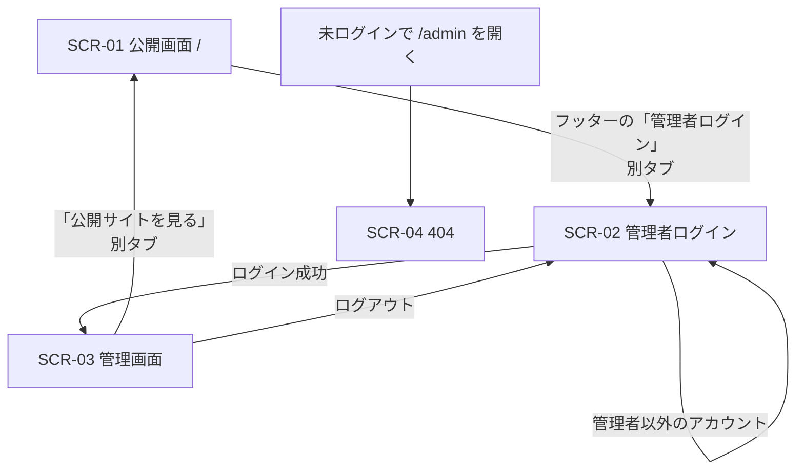

# 画面設計

- **対象**：Akiko Portfolio（個人ポートフォリオサイト）
- **作成日**：2026-11-28
- **状態**：確定（公開中の画面をもとに作成）。画面を変えたときは、この文書も更新する
- **正とするもの**：`frontend/src/app/`
- **関連**：[要件定義](./要件定義.md)（機能 ID）／[API 設計](./API設計.md)

## 1. 画面一覧

| ID | 画面 | パス | 利用者 | 対応する機能 |
| --- | --- | --- | --- | --- |
| SCR-01 | 公開画面 | `/` | 閲覧者 | P-1〜P-5 |
| SCR-02 | 管理者ログイン | `/admin/login` | 管理者 | A-1 |
| SCR-03 | 管理画面 | `/admin` | 管理者 | A-1〜A-8 |
| SCR-04 | 見つからない（404） | 存在しないパス、未ログインの `/admin` | だれでも | A-2 |

| 公開画面 | 管理画面 |
| --- | --- |
|  |  |

## 2. 画面遷移

- ログイン・ログアウトのあとは、ページ全体を読み込み直す。ログアウト後にブラウザの「戻る」で管理画面が見えないようにするため
- 公開画面と管理画面を行き来するリンクは、別タブで開く。編集しながら公開画面を確かめられるようにするため

## 3. 各画面の構成

### SCR-01 公開画面（`/`）

上から順に、次の部分を並べる。ヘッダーのメニューから、各部分へ移動できる。

| 部分 | 内容 | 機能 ID |
| --- | --- | --- |
| ヘッダー | サイト名と、「私について」「制作実績」「スキル」「お問い合わせ」へのメニュー。スクロールしても上に残る | － |
| トップ | 日本語名・英語名・見出し・プロフィール画像。「実績を見る」「お問い合わせ」ボタン | P-1 |
| プロフィール | 自己紹介・所在地と、「過去・現在・未来」の3つのカード | P-1 |
| 実績 | 作品のカード（画像・タイトル・説明・使用技術・GitHub とデモへのボタン） | P-2 |
| スキル | カテゴリーの見出しごとに、スキルのカード（スキル名・説明） | P-3 |
| お問い合わせ | 名前・メールアドレス・本文のフォーム | P-4 |
| フッター | 著作権表示と「管理者ログイン」へのリンク | P-5 |

データがない場合の表示：

- プロフィールがない：名前・見出しは決まった文を出し、画像の代わりに「AF」の文字を出す
- 画像がない：「プロフィール画像」「作品画像」の文字を出す
- スキルの説明がない：スキル名だけを出す
- GitHub やデモの URL がない：そのボタンを出さない

「過去・現在・未来」の3つのカードの文章は、管理画面では変えられない（コードに直接書いている）。

### SCR-02 管理者ログイン（`/admin/login`）

| 部分 | 内容 |
| --- | --- |
| フォーム | メールアドレス、パスワード、「ログイン」ボタン |
| メッセージ | ログインに失敗したときに、フォームの下に赤字で出す |

### SCR-03 管理画面（`/admin`）

ログインした管理者だけが表示できる。上から順に、次の部分を並べる。

| 部分 | 内容 | 機能 ID |
| --- | --- | --- |
| ヘッダー | 「ポートフォリオ管理」、「公開サイトを見る」リンク、ログアウトボタン | A-1・A-8 |
| お問い合わせ | 未読の件数と、新しい順の一覧（既読・未読、受信日時、名前、メールアドレス、本文、既読の切り替えボタン）。見落とさないよう、一番上に置く | A-7 |
| プロフィール画像 | 今の画像と、画像を選んで更新するフォーム | A-6 |
| プロフィールを編集 | 名前・日本語名・見出し・自己紹介・所在地 | A-3 |
| 実績を追加 | 新しい実績の入力フォーム | A-4 |
| 実績を編集 | 登録済みの実績ごとに、編集フォーム・画像の更新・削除ボタン | A-4・A-6 |
| スキルを登録 | 新しいスキルの入力フォーム | A-5 |
| 登録済みスキル | 登録済みのスキルごとに、編集フォームと削除ボタン | A-5 |

保存は、フォームごとの保存ボタンで行う。保存ボタンを押したフォームの内容だけが保存されるので、**1件直すたびに、そのフォームの保存ボタンを押す。**

### SCR-04 見つからない（404）

Next.js の標準の 404 画面を使う。未ログインや管理者以外で `/admin` を開いたときも、管理画面があることを知らせないため、同じ 404 を出す。

## 4. 入力チェック

入力チェックは3か所で行う。ブラウザでのチェックは使いやすさのため、サーバーでのチェックは安全のため。

| 段階 | 場所 | 主な内容 |
| --- | --- | --- |
| 1 | ブラウザ | 必須（`required`）、文字数（`maxLength`）、URL・メールの形式、表示順の範囲、画像の形式と大きさ |
| 2 | Next.js のサーバー（Server Action） | 1と同じ内容をもう一度。管理者かどうかの確認 |
| 3 | Express | 1と同じ内容をもう一度。DB に保存する直前の最後の確認 |

### フォームごとの項目

上限の数値は[要件定義](./要件定義.md)の §4 と同じ。

| フォーム | 必須 | 任意 | 補足 |
| --- | --- | --- | --- |
| お問い合わせ | 名前、メールアドレス、本文 | － | 人には見えない入力欄（ハニーポット）を1つ置く |
| プロフィール | 名前、見出し、自己紹介 | 日本語名、所在地 | 見出しと自己紹介は改行できる |
| 実績 | タイトル、説明、使用技術、表示順 | GitHub の URL、デモの URL | 使用技術は「,」か「、」で区切って入力する |
| スキル | スキル名、表示順 | 説明、カテゴリー | カテゴリーが空なら、公開画面では「その他」にまとめる |
| 画像 | 画像ファイル | － | JPEG・PNG・WebP、1MB まで |

## 5. メッセージ

### 公開画面のお問い合わせ

| 場面 | 表示 |
| --- | --- |
| 送信中 | ボタンが「送信中...」になり、押せなくなる |
| 成功 | お問い合わせを送信しました。ありがとうございます。 |
| 未入力 | 名前、メールアドレス、お問い合わせ内容を入力してください。 |
| メールの形式が違う | メールアドレスの形式が正しくありません。 |
| 文字数オーバー | 入力できる文字数を超えています。 |
| 回数制限 | ただいま送信が混み合っています。時間をおいてもう一度お試しください。 |
| 設定の問題・通信の失敗 | 現在送信できません。時間をおいてもう一度お試しください。 |

ハニーポットに入力があったときも「成功」と同じ表示にする（ボットに見破られないため）。

### 管理者ログイン

| 場面 | 表示 |
| --- | --- |
| メールアドレスかパスワードが違う | メールアドレスまたはパスワードが正しくありません。 |
| メールアドレスの形式が違う | メールアドレスの形式が正しくありません。 |
| 何度も失敗した | ログイン試行回数が多すぎます。時間をおいて再度お試しください。 |
| アカウントが無効 | このアカウントは無効になっています。 |
| 管理者ではない | このアカウントは管理者として登録されていません。 |
| そのほか | ログイン情報を確認できませんでした。／ログインに失敗しました。 |

ログイン中はボタンが「ログイン中...」になり、押せなくなる。

### 管理画面

| 場面 | 表示 |
| --- | --- |
| 削除ボタンを押した | 確認のダイアログ（「○○」を削除しますか？） |
| 画像が 1MB を超えている | 画像サイズは1MB以下にしてください（フォームの下に赤字） |
| ログアウトに失敗した | ログアウトに失敗しました。（ダイアログ） |
| お問い合わせがない | お問い合わせはまだありません。 |
| 保存が成功した | 画面が読み込み直され、新しい内容が表示される（メッセージは出さない） |
| 保存が失敗した | Next.js の標準のエラー画面になる |

## 6. 画面の幅への対応

| 幅 | 公開画面 | 管理画面 |
| --- | --- | --- |
| スマートフォン | 1列。ヘッダーのメニューは出さない | 1列 |
| タブレット（`sm` 以上） | スキルを2列 | ヘッダーの文字とボタンを横に並べる |
| パソコン（`md`・`lg` 以上） | トップを左右2列、実績を2列、スキルを3列。ヘッダーのメニューを出す | 同上 |

## 7. 未確定事項

最初の2つ（保存結果の表示・まとめて保存）は、#44 で対応する。

- **保存結果の表示**：管理画面で保存しても「保存しました」などのメッセージが出ない。保存の失敗も、画面の中ではなく標準のエラー画面になる
- **まとめて保存**：複数のフォームをまとめて保存する方法はない。どのフォームが未保存かも、画面からは分からない
- **スマートフォンのメニュー**：スマートフォンの幅ではヘッダーのメニューが出ない（ページを下へスクロールして移動する）
- **エラー画面・404 画面**：Next.js の標準のものを使っている。サイトの見た目に合わせるかは未定
- **画像の削除**：画像を消して「画像なし」に戻す操作はない
