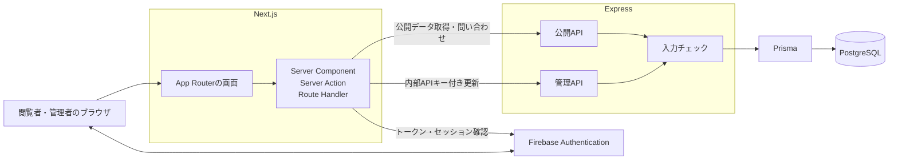
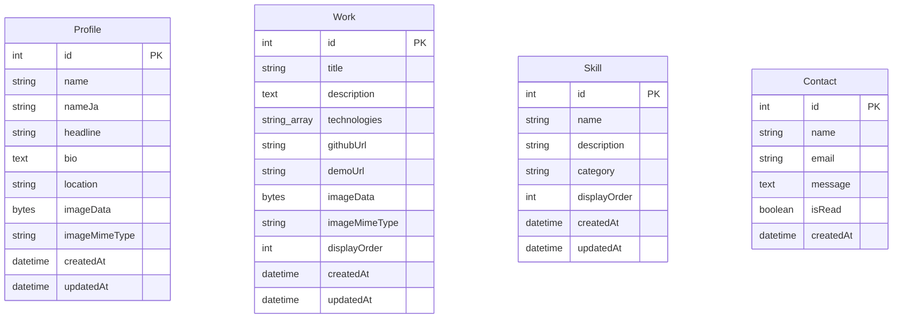
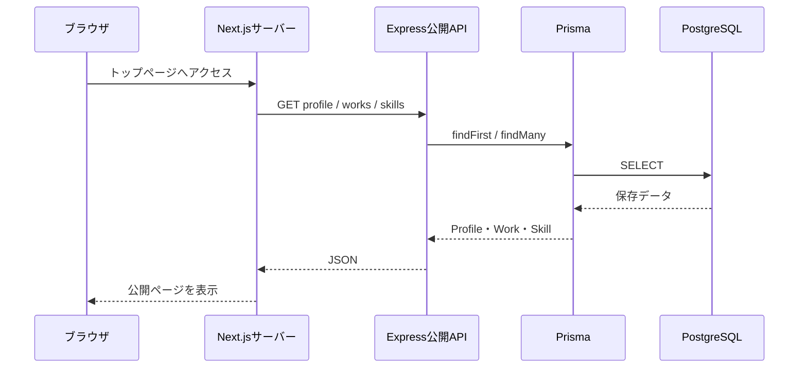
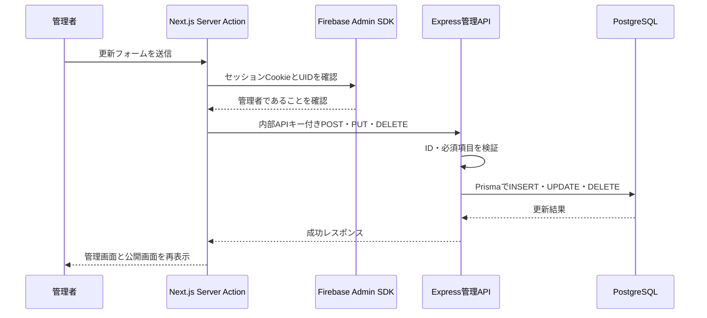
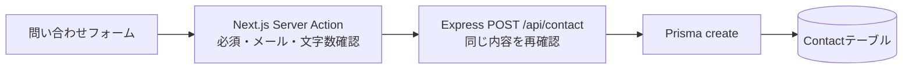
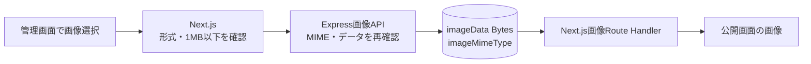

# Akiko Portfolio 仕組みと復習ノート

## 1. アプリ概要

学習して作った作品を自分で追加し、順番を変えながら育てていけるポートフォリオアプリです。プロフィール・実績・スキルは公開し、内容を変更できるのは管理者だけにしています。

公開画面には問い合わせフォームがあり、入力内容はExpressとPrismaを通ってPostgreSQLへ保存されます。プロフィール画像と作品画像もファイルではなくDBに保存します。

| 利用者 | できること |
| --- | --- |
| 閲覧者 | プロフィール・作品・スキルの閲覧、GitHub・デモページへの移動、問い合わせ送信 |
| 管理者 | メール／パスワードでログイン、プロフィール・実績・スキル・画像の登録・更新・削除 |
| 管理者以外 | `/admin`へ直接アクセスしてもHTTP 404 |

## 2. 使用技術

| 担当 | 技術 | このアプリでの役割 |
| --- | --- | --- |
| フロントエンド | Next.js App Router・TypeScript・React | 公開画面、管理画面、フォーム、サーバー処理 |
| バックエンド | Express・TypeScript | 公開API、管理API、入力チェック |
| ORM | Prisma | TypeScriptからPostgreSQLを操作 |
| DB | PostgreSQL 16 | プロフィール、実績、画像、スキル、問い合わせを保存 |
| 認証 | Firebase Authentication・Admin SDK | 本人確認、管理者UIDの確認、セッションCookie発行 |
| 開発環境 | Docker Compose | PostgreSQLコンテナの起動 |

## 3. システム構成図

ブラウザからExpressへ直接アクセスせず、必ずNext.jsのサーバー機能を経由します。



Next.jsが画面とExpressの間に入るため、DB接続情報や内部APIキーをブラウザへ渡さずに処理できます。

## 4. DB設計（ER図）

現在の4モデルには外部キーによる直接の関連はありません。それぞれが独立したテーブルとして保存されます。



| モデル | 保存内容 | 主に操作する画面 |
| --- | --- | --- |
| `Profile` | 氏名、見出し、自己紹介、地域、プロフィール画像 | 公開画面・管理画面 |
| `Work` | 作品名、説明、使用技術、URL、表示順、作品画像 | 実績欄・管理画面 |
| `Skill` | スキル名、説明、カテゴリー、表示順 | スキル欄・管理画面 |
| `Contact` | 名前、メールアドレス、問い合わせ本文、確認状態 | 問い合わせフォーム |

設計は `backend/prisma/schema.prisma`、作成されたテーブルは `backend/prisma/migrations` で確認できます。

## 5. データの流れ

ER図はDBの構造を示し、次の図は画面操作からDBまでの処理順を示します。

### 公開画面を表示する



### 管理画面から内容を更新する



### 問い合わせを保存する



### 画像をDBへ保存・表示する



画像本体は `imageData`、画像の種類は `imageMimeType` に分けて保存します。

## 6. 画面・API・DB対応表

| 操作 | Next.js側 | Express API | DB |
| --- | --- | --- | --- |
| 公開内容を表示 | `getPortfolioContent()` | `GET /api/profile`・`works`・`skills` | `Profile`・`Work`・`Skill` |
| 問い合わせ送信 | `sendContact()` | `POST /api/contact` | `Contact` |
| 管理者ログイン | `/api/auth/session` | Expressは使用しない | Firebaseで管理 |
| プロフィール更新 | `updateProfile()` | `PUT /api/admin/profile/:id` | `Profile` |
| 実績追加・更新・削除 | `createWork()`・`updateWork()`・`deleteWork()` | `POST/PUT/DELETE /api/admin/works` | `Work` |
| スキル追加・更新・削除 | `createSkill()`・`updateSkill()`・`deleteSkill()` | `POST/PUT/DELETE /api/admin/skills` | `Skill` |
| プロフィール画像更新 | `updateProfileImage()` | `PUT /api/admin/profile/:id/image` | `Profile.imageData` |
| 作品画像更新 | `updateWorkImage()` | `PUT /api/admin/works/:id/image` | `Work.imageData` |

管理APIはNext.jsサーバーだけが持つ `INTERNAL_API_KEY` で保護されています。

## 7. 認証と404の仕組み

```mermaid
flowchart TD
    LOGIN[メール・パスワードを入力]
    AUTH[Firebase Authentication]
    TOKEN[IDトークンをNext.jsへ送る]
    UID{UIDが<br/>FIREBASE_ADMIN_UIDと一致?}
    COOKIE[HttpOnlyセッションCookieを発行]
    ADMIN[/adminを表示]
    NOTFOUND[HTTP 404]

    LOGIN --> AUTH --> TOKEN --> UID
    UID -->|一致| COOKIE --> ADMIN
    UID -->|不一致| NOTFOUND
```

パスワード間違いはログインフォームにエラーを表示します。HTTP 404は、未認証または管理者以外が `/admin` へアクセスした場合に使用します。

## 8. バリデーション

| 対象 | ブラウザ・Next.js | Express |
| --- | --- | --- |
| 問い合わせ | 必須、メール形式、最大文字数 | 必須、メール形式、100・254・2000文字以内 |
| プロフィール | ID、必須、最大文字数 | ID、必須、最大文字数 |
| 実績 | ID、必須、URL形式、表示順、最大文字数 | ID、必須、URL形式、技術数・文字数、表示順0〜9999 |
| スキル | ID、必須、表示順、最大文字数 | ID、必須、表示順0〜9999、最大文字数 |
| 画像 | JPEG・PNG・WebP、1MB以下 | MIMEタイプ、空データ、1MB以下 |

ブラウザの入力属性、Next.js Server Action、Express APIの3段階で確認します。ブラウザ側を回避したリクエストでも、Express側で不正値を拒否します。

## 9. 主なファイル

```text
akiko-portfolio/
├─ frontend/
│  └─ src/
│     ├─ app/page.tsx                 公開画面
│     ├─ app/contact-actions.ts       問い合わせ送信
│     ├─ app/admin/page.tsx           管理画面
│     ├─ app/admin/actions.ts         管理画面のサーバー処理
│     ├─ app/admin/delete-button.tsx  削除前の確認ボタン
│     ├─ app/api/auth/session         ログインセッション作成
│     ├─ lib/require-admin.ts         管理者確認・404
│     └─ lib/admin-form-validation.test.ts  フォーム検証テスト
├─ backend/
│  ├─ prisma/schema.prisma            DB設計
│  └─ src/
│     ├─ index.ts                     Express起動・管理API保護
│     ├─ routes/                      公開・管理・画像API
│     └─ validation/                  管理API検証と自動テスト
├─ docker-compose.yml                 PostgreSQL起動設定
└─ scripts/sync-internal-api-key.mjs  内部APIキー同期
```

## 10. 起動・DB確認

### 1. PostgreSQLを起動

目的：保存先のDBを起動します。

```powershell
cd C:\dev\akiko-portfolio
docker compose up -d
docker compose ps
```

`akiko-portfolio-db` が `healthy` なら正常です。

### 2. Expressを起動

目的：DBを操作するAPIを起動します。

```powershell
cd C:\dev\akiko-portfolio\backend
npm run dev
```

`http://localhost:4000/health` で `status: ok` を確認します。

### 3. Next.jsを起動

目的：公開画面と管理画面を起動します。

```powershell
cd C:\dev\akiko-portfolio\frontend
npm run dev
```

ターミナルの `Local:` に表示された3000または3001のURLを開きます。

### 4. DBの保存内容を確認

目的：画面から登録した値がどのテーブルへ入ったか確認します。

```powershell
cd C:\dev\akiko-portfolio\backend
npx prisma studio
```

通常は `http://localhost:5555` が開き、`Profile`・`Work`・`Skill`・`Contact` を表形式で確認できます。

## 11. 提出前チェック

| 確認項目 | 現在の状態 |
| --- | --- |
| Frontend ESLint | 合格 |
| Frontend本番ビルド | 合格 |
| Backend TypeScriptビルド | 合格 |
| Prismaスキーマ | 合格 |
| 未認証 `/admin` のHTTP 404 | 実測で確認済み |
| Backend ESLint | 合格 |
| 自動テスト | Frontend 7件・Backend 8件、全15件合格 |
| 実績・スキル管理 | 登録・更新・削除を実装済み |
| 管理項目バリデーション | URL・最大文字数・表示順を両サーバーで確認 |

MUST要件を満たし、提出前に挙がった品質改善も完了しています。今後の拡張候補は、問い合わせ一覧・画像削除・本番公開です。

## 12. 私があとから確認したいポイント

今回実際につまずいた点を、原因と確認場所が分かる形で残します。

| 画面・エラー | 意味と確認すること |
| --- | --- |
| Next.jsが3001で起動 | 3000番を別プロセスが使用中。ターミナルの`Local:`に表示されたURLを開く |
| Expressの`Cannot GET /` | ExpressのトップURLには画面を作っていないため。疎通確認は`/health`を使用する |
| 管理APIが401 | FrontendとBackendの`INTERNAL_API_KEY`を揃え、両方のサーバーを再起動する |
| `/admin`が404 | 未ログインまたは管理者UIDが違うときの正しい動作 |
| 画像取得が502 | ExpressまたはPostgreSQLが起動しているか確認する |
| 問い合わせの保存先 | `npx prisma studio`を起動し、`Contact`テーブルを確認する |

覚えておきたい中心線は、`ブラウザ → Next.js → Express → Prisma → PostgreSQL`です。エラーが起きたら、この順番のどこまで動いているかを確認します。

### もう一度品質を確認するコマンド

```powershell
# Frontend
cd C:\dev\akiko-portfolio\frontend
npm run test
npm run lint
npm run build

# Backend
cd C:\dev\akiko-portfolio\backend
npm run test
npm run lint
npm run build
npx prisma validate
```
